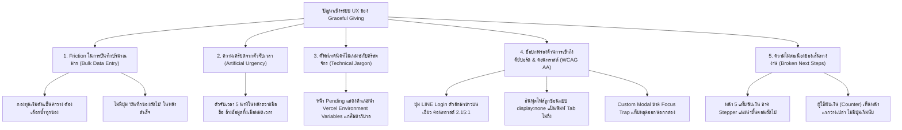

# Graceful Giving — Comprehensive UX Audit & Review Report

> **เอกสารรายงานการประเมินและตรวจสอบประสบการณ์ผู้ใช้งาน (UX Audit & Review)**  
> **ระบบ:** Graceful Giving (ระบบบัญชีและการเงินคริสตจักร — Fintech for Ministry)  
> **วันที่ประเมิน:** 9 พฤศจิกายน 2026  
> **มาตรฐานและกรอบการตรวจสอบ:** Cognitive Load, Visual Hierarchy, WCAG 2.2 Level AA  
> **ขอบเขต:** ตรวจสอบจาก Source Code จริง, สถาปัตยกรรมระบบ, โทเคนการออกแบบ (Design Tokens) และโฟลว์การทำงานจริงใน Repository

---

## 1. Executive Summary (บทสรุปสำหรับผู้บริหารและทีมพัฒนา)

ระบบ **Graceful Giving** ถูกออกแบบมาเพื่อเป็นเครื่องมือจัดการการเงินและพันธกิจคริสตจักรที่โปร่งใส ซื่อสัตย์ และมีประสิทธิภาพ (Fintech for Ministry) ครอบคลุมตั้งแต่การถวายทรัพย์ของสมาชิกผ่าน LINE/QR, การกระทบยอดสลิปด้วย AI, การนับเงินถวายประจำสัปดาห์ 5 ขั้นตอน, การบันทึกและอนุมัติรายจ่ายแบบลงนามคู่ (Dual Authorization), การบริหารกองทุนเฉพาะกิจ, การควบคุมงบประมาณ ไปจนถึงการจัดทำรายงานการเงิน

### ภาพรวมผลการประเมิน (High-Level Verdict)
- **จุดแข็งที่โดดเด่น:**
  1. **สถาปัตยกรรมความปลอดภัยและการเงินเข้มงวด:** มีระบบตรวจสิทธิ์ตามบทบาทคริสตจักร (Role-Based Access Control) ซ่อน/มาสก์ชื่อผู้ถวายตามกฎหมายและระเบียบคริสตจักร, มี SweetAlert Confirm ป้องกันการทำรายการผิดพลาดในจุดวิกฤตทางการเงิน (Financial Integrity).
  2. **ระบบ Design System สม่ำเสมอ:** ใช้พาเลตต์สี Dark Warm Charcoal (`#0E0A08`), พื้นผิว Raised Surface (`#211915`), ข้อความใกล้ขาว (`#FFF7ED`), สีส้มแบรนด์ CTA และฟอนต์ที่รองรับภาษาไทย (`IBM Plex Sans Thai`) ชัดเจน.
  3. **การกระทบยอดและการตรวจสอบล่วงหน้า:** ระบบมี Pre-Post Checklist ที่ยอดเยี่ยมในหน้าสรุปนับเงินถวาย (`ReconciliationSummaryTab.tsx`) และระบบตรวจสลิปแยกหมวดหมู่ (`SplitEditor.tsx`).

- **จุดวิกฤตและอุปสรรคสำคัญสำหรับผู้ใช้ทั่วไปและผู้สูงอายุ (Key UX Friction & Gaps):**
  1. **Cognitive Overload ในขั้นตอนนับเงินและการบันทึก:** ในหน้าบันทึกถวาย (`NewOffering.tsx`) และใบนับซอง (`EnvelopesTab.tsx`) ระบบตั้งค่าเริ่มต้นกองทุนเป็นค่าว่าง (`— เลือกกองทุน —`) ทำให้เหรัญญิกหรือผู้นับเงินต้องคลิกเลือกซ้ำๆ ทุกซอง และเมื่อบันทึกถวายสำเร็จ หน้าต่าง Success กลับมีเพียงปุ่มเดียวที่พากลับไปหน้ารวมรายการ ไม่มีปุ่ม "บันทึกซองถัดไป" สำหรับการนับเงินปริมาณมากในบ่ายวันอาทิตย์.
  2. **ความเครียดจากตัวนับเวลาถอยหลัง (Artificial Urgency):** ในหน้าถวายทรัพย์ของสมาชิก (`GivingStation.tsx`) มีตัวจับเวลา 5 นาที (300 วินาที) ที่หากหมดเวลาจะล้างข้อมูลที่สมาชิกเลือกไว้ทิ้งทันที (`resetFlow()`) ซึ่งสร้างความวิตกกังวลอย่างมากต่อสมาชิกคริสตจักรสูงวัยที่กำลังเปิดแอปธนาคารเพื่อโอนเงิน.
  3. **ศัพท์เทคนิคที่ไม่เหมาะกับบริบทคริสตจักร (Technical Jargon):** ในหน้า Login เมื่อผู้ใช้ใหม่มีสถานะ `pending` ระบบแสดงข้อความให้ผู้ดูแลระบบ "คัดลอก LINE OpenID ไปใส่ใน Vercel Environment Variables ช่อง OWNER_OPEN_ID" ซึ่งเป็นศัพท์เฉพาะของนักพัฒนาที่สร้างความสับสนอย่างรุนแรงแก่ศิษยาภิบาลหรือกรรมการคริสตจักร.
  4. **ช่องโหว่ความสามารถในการเข้าถึง (WCAG 2.2 AA Violations):**
     - **Contrast อัตรา 2.15:1 บนปุ่ม LINE Login:** สีข้อความ `text-[var(--ink)]` (ขาว `#FFF7ED`) บนพื้นหลัง `bg-line-brand` (เขียว `#06C755`) สอบตกเกณฑ์ WCAG 1.4.3 (ขั้นต่ำ 4.5:1) อย่างรุนแรง.
     - **Keyboard Trap & Missing Focus Trapping:** กล่อง Modal ปฏิเสธคำขอและยกเลิกคำขอใน `Approvals.tsx` และสร้างกองทุนใน `Funds.tsx` เป็น Custom `
` ที่ไม่มีการกักโฟกัส (Focus Trap) ทำให้ผู้ใช้คีย์บอร์ดแท็บหลุดออกไปเบื้องหลัง.
     - **Inoperable File Uploads:** อินพุตอัปโหลดไฟล์ใน `NewExpense.tsx` และ `GivingStation.tsx` ถูกซ่อนด้วย `className="hidden"` โดยไม่มีคีย์บอร์ดแฮนเดลเลอร์ ทำให้ผู้ใช้ที่ควบคุมด้วยคีย์บอร์ดไม่สามารถเข้าถึงการอัปโหลดใบเสร็จได้เลย.

---

## 2. Overall UX Scorecard (คะแนนประเมินภาพรวม)

การประเมินใช้สเกลคะแนน **1 ถึง 5**:
- **1 (Unacceptable / Critical Gaps):** มีอุปสรรครุนแรง ไม่สามารถใช้งานได้ด้วยตนเอง เสี่ยงต่อข้อมูลหรือการเงิน
- **2 (Poor / High Friction):** สร้างภาระการคิดสูง ผู้ใช้ลังเล หลงทางบ่อย มีจุดผิดพลาดได้ง่าย
- **3 (Acceptable / Needs Refinement):** ใช้งานได้สำเร็จ แต่มีความสะดุด ขาดความช่วยเหลือ และมีข้อบกพร่องด้าน Accessibility
- **4 (Good / Minor Polish):** ใช้งานสะดวก ลำดับภาพชัดเจน สื่อสารเข้าใจง่าย มีจุดปรับปรุงเล็กน้อย
- **5 (Exceptional / Fully Inclusive):** ไร้รอยต่อ ลดภาระความจำสมบูรณ์ เข้าถึงได้ตามมาตรฐาน WCAG 2.2 ระดับ AA

| มิติการประเมิน (Dimension) | คะแนนเฉลี่ย (Score) | สถานะ (Status) | คำอธิบายสรุป |
| :--- | :---: | :---: | :--- |
| **1. Cognitive Load (ภาระการรู้คิด)** | **3.2 / 5.0** | ⚠️ ต้องปรับปรุง | ฟอร์มทำงานได้ดีแต่ขาด Smart Defaults, ขาดโฟลว์การทำงานต่อเนื่องสำหรับงานนับเงินปริมาณมาก, มีตัวนับเวลาสร้างแรงกดดัน, และมีศัพท์เทคนิคของระบบคลาวด์ |
| **2. Visual Hierarchy (ลำดับการมองเห็น)** | **3.8 / 5.0** | 🟢 อยู่ในเกณฑ์ดี | การจัดกลุ่ม Bento Card และโทนสีชัดเจน สถานะทางการเงินใช้สีและข้อความคู่กัน แต่บนมือถือหน้าที่มีการแบ่งจอ (Split View) ขาดลำดับการเลื่อนสายตาที่ชัดเจน |
| **3. WCAG 2.2 Level AA (การเข้าถึง)** | **2.9 / 5.0** | 🔴 ต้องแก้ไขเร่งด่วน | พบปัญหา Contrast ต่ำบนปุ่มหลัก LINE, ขาดการเชื่อมโยง `<label>` กับ `<input>` ในหลายฟอร์ม, ขาด Focus Trap ใน Custom Modal, และปุ่มอัปโหลดไฟล์เข้าถึงด้วยคีย์บอร์ดไม่ได้ |
| **ภาพรวมทั้งระบบ (Overall Score)** | **3.3 / 5.0** | **Acceptable with Critical Fixes Required** |

---

## 3. Score Breakdown by Module & Screen (ตารางคะแนนแยกตามหน้าจอและโมดูล)

| # | หน้าจอ / โมดูล (Screen / Module) | เส้นทาง (Route) | บทบาทที่ใช้งาน (Target Persona) | Cognitive Load (1-5) | Visual Hierarchy (1-5) | Accessibility (1-5) | คะแนนเฉลี่ย | สถานะความพร้อม |
| :-: | :--- | :--- | :--- | :-: | :-: | :-: | :-: | :-: |
| 1 | เข้าสู่ระบบ (Login) | `/login` | ทุกคน / ผู้ดูแลระบบ | 3.0 | 4.0 | 2.0 | **3.0** | ⚠️ ปรับปรุงด่วน (Contrast & Technical Jargon) |
| 2 | หน้าหลัก (Dashboard) | `/` | เหรัญญิก / ผู้นำ / สมาชิก | 4.0 | 4.5 | 4.0 | **4.2** | 🟢 ยอดเยี่ยม (แบ่งหมวดหมู่และงานค้างชัดเจน) |
| 3 | บันทึกการถวาย (New Offering) | `/offerings/new` | เหรัญญิก / ผู้ช่วยการเงิน | 3.0 | 4.0 | 3.0 | **3.3** | ⚠️ ขาดปุ่มบันทึกซองถัดไป & กองทุนค่าว่าง |
| 4 | บัญชีเงินถวาย (Offerings Ledger) | `/offerings` | เหรัญญิก / กรรมการ | 4.0 | 4.0 | 4.0 | **4.0** | 🟢 ดีมาก (มีมาสก์ชื่อผู้ถวายตามสิทธิ์) |
| 5 | นับเงินถวายประจำสัปดาห์ (Counting) | `/counting` | คณะกรรมการนับเงิน / เหรัญญิก | 4.0 | 4.0 | 3.5 | **3.8** | 🟢 ดี (มีแท็บกรองรอบชัดเจน) |
| 6 | หน้ารายละเอียดนับเงิน (Counting Detail) | `/counting/:id` | คณะกรรมการนับเงิน / เหรัญญิก | 3.0 | 3.5 | 3.0 | **3.2** | ⚠️ ขาด Stepper นำทาง 5 ขั้นตอน |
| 7 | บันทึกรายจ่ายใหม่ (New Expense) | `/expenses/new` | เหรัญญิก / ผู้มีอำนาจเบิก | 4.0 | 4.5 | 2.5 | **3.7** | ⚠️ ฟอร์มดีเยี่ยมแต่อัปโหลดไฟล์เข้าถึงด้วยคีย์บอร์ดไม่ได้ |
| 8 | สมุดบัญชีรายจ่าย (Expenses Ledger) | `/expenses` | เหรัญญิก / ศิษยาภิบาล | 4.0 | 4.0 | 4.0 | **4.0** | 🟢 ดีมาก |
| 9 | รายการธุรกรรมรวม (Transactions Ledger) | `/transactions` | เหรัญญิก / ผู้ตรวจสอบ | 4.5 | 4.5 | 4.5 | **4.5** | 🌟 ต้นแบบที่ดีเยี่ยม (ARIA Table, Mobile Feed, KPI) |
| 10 | การอนุมัติเบิกจ่าย (Approvals) | `/approvals` | ผู้ลงนามธนาคาร / เหรัญญิก | 3.5 | 4.0 | 2.5 | **3.3** | ⚠️ Custom Modal ขาด Focus Trap |
| 11 | ยื่นคำขอเบิกเงิน (New Withdrawal) | `/withdrawals/new` | สมาชิก / หัวหน้าพันธกิจ | 4.0 | 4.0 | 3.5 | **3.8** | 🟢 ใช้งานง่าย |
| 12 | กล่องสลิป LINE (Giving Inbox) | `/giving/inbox` | เหรัญญิก / ผู้ตรวจสอบสลิป | 3.0 | 3.0 | 2.0 | **2.7** | 🔴 ต้องปรับปรุง (Mobile Layout & Div onClick) |
| 13 | จุดถวายอัตโนมัติ (Giving Station) | `/giving/station` | สมาชิกคริสตจักร / ผู้มาร่วม | 2.5 | 3.5 | 3.0 | **3.0** | ⚠️ ตัวนับเวลาถอยหลัง 5 นาทีสร้างความเครียด |
| 14 | หน้าลิงก์ถวายสาธารณะ (Give Public) | `/give` | สมาชิก / ผู้ร่วมประชุม | 3.5 | 4.0 | 2.0 | **3.2** | ⚠️ ปัญหา Contrast บนปุ่ม LINE Login |
| 15 | งบประมาณพันธกิจ (Budgets & Detail) | `/budgets` | คณะกรรมการงบประมาณ | 4.0 | 4.5 | 4.5 | **4.3** | 🟢 ยอดเยี่ยม (Progress bar เข้าถึงได้สมบูรณ์) |
| 16 | กองทุนคริสตจักร (Funds & Detail) | `/funds` | เหรัญญิก / ผู้นำ | 4.0 | 4.0 | 3.0 | **3.7** | ⚠️ Modal ขาด Focus Trap |
| 17 | ทะเบียนสมาชิก (Members & Detail) | `/members` | ฝ่ายทะเบียน / กรรมการ | 4.0 | 4.0 | 3.5 | **3.8** | 🟢 ดี |
| 18 | รายงานการเงินและส่งออก (Reports) | `/reports` | เหรัญญิก / สภาคริสตจักร | 3.5 | 3.5 | 2.5 | **3.2** | ⚠️ กราฟแท่งขาดคีย์บอร์ด & ตารางขาด Scope |
| 19 | ตั้งค่าระบบ (Settings) | `/settings` | Super Admin | 3.5 | 3.5 | 3.0 | **3.3** | ⚠️ เนื้อหายาวมาก ขาดการจัดกลุ่มเชิงลำดับขั้น |
| 20 | วิซาร์ดตั้งค่าเริ่มต้น (Church Setup) | `/setup` | ศิษยาภิบาล / Super Admin | 3.0 | 3.5 | 2.0 | **2.8** | 🔴 ปุ่มขั้นตอนเล็กเกินไป (8px) & ขาด Label For |

---

## 4. Evaluation Methodology & Persona Profiles (ระเบียบวิธีและกลุ่มผู้ใช้เป้าหมาย)

### เกณฑ์การทดสอบตามคำถามคุณภาพ 7 ข้อ (UX Quality Questions):
1. **Can I understand where I am?** (ฉันเข้าใจหรือไม่ว่าอยู่ที่ไหน?)
2. **Can I understand what I should do?** (ฉันเข้าใจหรือไม่ว่าต้องทำอะไรบนหน้านี้?)
3. **Can I identify the next action?** (ฉันระบุการกระทำถัดไปได้ทันทีหรือไม่?)
4. **Can I complete the task without guessing?** (ฉันทำงานสำเร็จได้โดยไม่ต้องเดาหรือไม่?)
5. **Can I recover from an error?** (เมื่อเกิดข้อผิดพลาด ฉันรู้วิธีแก้ไขและย้อนกลับหรือไม่?)
6. **Can I confirm that my action succeeded?** (ฉันมั่นใจได้อย่างไรว่าสิ่งที่ทำสำเร็จแล้ว?)
7. **Can I continue without asking someone for help?** (ฉันทำงานต่อได้โดยไม่ต้องขอความช่วยเหลือหรือไม่?)

### กลุ่มผู้ใช้งานเป้าหมายในบริบทคริสตจักรไทย (Target Personas):
- **ป้าพรทิพย์ (อายุ 64 ปี) — เหรัญญิกและผู้นับเงินอาวุโส:** ใช้มือถือจอเล็ก มีปัญหาสายตายาวและคอนทราสต์ ไม่คุ้นเคยกับศัพท์เทคนิคอังกฤษ ต้องการระบบที่มีตัวช่วยแนะนำ ขั้นตอนที่ชัดเจน และปุ่มกดขนาดใหญ่ ไม่เร่งเวลา
- **อาจารย์สมเกียรติ (อายุ 58 ปี) — ศิษยาภิบาลคริสตจักร:** ตรวจสอบยอดรวม อนุมัติการเบิกจ่ายงบประมาณผ่านสมาร์ทโฟน ไม่ต้องการเห็นข้อความผิดพลาดของระบบเซิร์ฟเวอร์หรือคลาวด์ ต้องการการยืนยันทางการเงินที่ปลอดภัย
- **น้องธีร์ (อายุ 28 ปี) — ผู้ช่วยเหรัญญิกรุ่นใหม่:** นำเข้าข้อมูลซองถวาย 50–100 ซองในบ่ายวันอาทิตย์ ต้องการความรวดเร็วในการคีย์ข้อมูลแบบไม่ต้องยกมือออกจากคีย์บอร์ด (Rapid Data Entry) และบันทึกต่อเนื่องได้ทันที
- **ลุงมนัส (อายุ 68 ปี) — สมาชิกคริสตจักร:** ถวายทรัพย์ประจำสัปดาห์ด้วยการสแกน QR บนป้ายหน้าห้องประชุม ต้องการหน้าเว็บที่อ่านง่าย ไม่บีบบังคับด้วยเวลานับถอยหลัง มีเลขบัญชีชัดเจนให้คัดลอก และแนบสลิปง่าย

---

## 5. Task-Oriented UX Review (ตรวจสอบเส้นทางการทำงานจริง 10 ภารกิจ)

### ภารกิจที่ 1: เข้าสู่ระบบ (Login & Onboarding Gate)
- **จุดเริ่มต้น:** ผู้ใช้เปิดหน้า `/login` หรือถูก Redirect มาจากหน้าที่มีการจำกัดสิทธิ์
- **สิ่งที่รับรู้ใน 5 วินาทีแรก:** เห็นข้อพระคัมภีร์ 2 โครินธ์ 9:7, ชื่อระบบเกรซกิฟวิง และปุ่มสีเขียว "เข้าสู่ระบบด้วย LINE" ชัดเจน
- **จุดที่ทำให้ลังเลหรือสับสน:**
  - เมื่อผู้ใช้ล็อกอินผ่าน LINE แล้ว แต่สถานะเป็น `pending` (รออนุมัติ): หน้าจอแสดงรหัส `openId` พร้อมข้อความแจ้งให้นำไปใส่ใน `Vercel Environment Variables ที่ช่อง OWNER_OPEN_ID` — ศิษยาภิบาลหรือผู้นำคริสตจักรทั่วไปที่ไม่ใช่โปรแกรมเมอร์จะไม่เข้าใจว่า Vercel คืออะไร และต้องทำอย่างไร ทำให้เกิดความตกใจและคิดว่าระบบพัง
  - ไม่มีปุ่ม "ตรวจสอบสถานะอีกครั้ง" มีเพียงปุ่ม "ออกจากระบบ" ผู้ใช้ไม่รู้ว่าหากแอดมินอนุมัติแล้วจะต้องทำอย่างไรต่อ (ต้องกดรีเฟรชบราวเซอร์เอง)
- **จุดที่สามารถกดผิด:** ผู้ใช้กด "ออกจากระบบ" ทำให้ต้องล็อกอินใหม่อีกรอบ ทั้งที่จริงแอดมินอาจจะกำลังกดอนุมัติในระบบ
- **การประเมิน 7 UX Quality Questions:**
  - *Can I understand what I should do?* ❌ ไม่ชัดเจนเมื่ออยู่ในสถานะ Pending
  - *Can I recover without asking someone for help?* ❌ ผู้ใช้ต้องโทรตามผู้ติดตั้งระบบ

---

### ภารกิจที่ 2: ดูภาพรวมและติดตามงานค้าง (Dashboard Overview & Task Queue)
- **จุดเริ่มต้น:** หน้าแรก `/` หลังผ่านการยืนยันตัวตน
- **สิ่งที่รับรู้ใน 5 วินาทีแรก:**
  - สำหรับเหรัญญิก: เห็นยอดคงเหลือรวมใน BalanceCard, สถานะงานค้างใน TaskQueue ("สลิปที่ต้องตรวจสอบ", "คำขอเบิกเงินที่ต้องลงนาม"), ปุ่มทำรายการเด่นชัด ("บันทึกการถวาย", "บันทึกรายจ่าย")
- **จุดที่ทำให้ลังเลหรือสับสน:**
  - สำหรับผู้ใช้ที่เป็น "คณะกรรมการนับเงิน" (COUNTER): ระบบไม่อนุญาตให้ดูยอดเงินคงเหลือและประวัติบัญชี (`canSeeFinance = false`) ทำให้พื้นที่ส่วนใหญ่ของแดชบอร์ดว่างเปล่า และปุ่ม "ทำรายการ" ไม่แสดงปุ่มนับเงิน ผู้ใช้บทบาทนี้นึกว่าระบบค้างหรือเปิดเมนูไม่ครบ ทั้งที่ภารกิจหลักของเขาคือนับเงินถวายประจำสัปดาห์
- **จุดที่สามารถกดผิด:** ผู้ใช้กดเปิดดูการตั้งค่าหรือเมนูที่ไม่มีสิทธิ์ แล้วเจอกล่อง "สิทธิ์การเข้าถึงถูกจำกัด"
- **การประเมิน 7 UX Quality Questions:**
  - *Can I identify the next action?* ✅ เด่นชัดมากสำหรับเหรัญญิก แต่ ❌ คลุมเครือสำหรับผู้ใช้นับเงิน (Counter)

---

### ภารกิจที่ 3: บันทึกการถวายทรัพย์ (Record Offering & Bulk Entry)
- **จุดเริ่มต้น:** คลิกปุ่ม "บันทึกการถวาย" จาก Dashboard หรือเมนู `/offerings/new`
- **สิ่งที่รับรู้ใน 5 วินาทีแรก:** เห็นขั้นตอนชัดเจน "1. เลือกประเภทการถวาย", "2. ระบุจำนวนเงิน", "3. เข้ากองทุน", "4. วิธีการรับเงิน"
- **จุดที่ทำให้ลังเลหรือสับสน:**
  - **ช่องเข้ากองทุนเริ่มต้นเป็นค่าว่าง:** แม้คริสตจักรจะมี "กองทุนทั่วไป" เป็นหลัก แต่ระบบไม่เลือกให้อัตโนมัติ ผู้ใช้ต้องกดเปิด Dropdown และเลือกกองทุนทุกครั้ง
  - **ไม่มีโฟลว์บันทึกซองต่อเนื่อง:** เมื่อกด "ยืนยันบันทึกการถวาย" ระบบเปิดหน้าต่างโมดอลยินดี ("บันทึกการถวายเรียบร้อยแล้ว") พร้อมปุ่มเดียวคือ "ดูรายการถวายทั้งหมด" ซึ่งนำผู้ใช้ออกจากหน้าฟอร์มไปยังหน้ารายการ ทำให้การบันทึกซองถวาย 50 ซองในวันอาทิตย์ต้องกดสลับไปมาถึง 100 ครั้ง!
- **จุดที่สามารถกดผิด:** ใส่จำนวนเงินผิดพลาด เช่น กด 50,000 บาทแทนที่จะเป็น 5,000 บาท แล้วกดส่งทันที ระบบไม่มีขั้นตอนตรวจสอบซ้ำสำหรับยอดเงินสูงผิดปกติ
- **การประเมิน 7 UX Quality Questions:**
  - *Can I complete the task without guessing?* ✅ ทำได้
  - *Can I continue without repetitive friction?* ❌ มีภาระการเลือกซ้ำสูงมาก

---

### ภารกิจที่ 4: บันทึกรายจ่ายและแนบใบเสร็จ (Record Expense & Attach Receipt)
- **จุดเริ่มต้น:** คลิกปุ่ม "บันทึกรายจ่าย" จาก Dashboard หรือ `/expenses/new`
- **สิ่งที่รับรู้ใน 5 วินาทีแรก:** หมวดหมู่รายจ่ายมีไอคอนสื่อความหมายชัดเจน (ค่าน้ำค่าไฟ, พันธกิจ, อภิบาล, อาคาร), ฟิลด์ยอดเงินตัวใหญ่สีแดงสื่อความหมายรายจ่าย
- **จุดที่ทำให้ลังเลหรือสับสน:**
  - มีระบบตรวจข้อผิดพลาดแบบอินไลน์ (Inline validation) ที่ยอดเยี่ยม (amount, description, fund)
  - หลังบันทึกสำเร็จ โมดอลมีปุ่ม "บันทึกรายจ่ายรายการถัดไป" และ "กลับสู่หน้ารายการรายจ่าย" ถือเป็นตัวอย่างที่ดีมาก
- **จุดบกพร่องด้านการเข้าถึง:** กล่องอัปโหลดใบเสร็จซ่อน `<input type="file" className="hidden">` ไว้ ทำให้ผู้พิการหรือผู้ใช้ที่สั่งงานด้วยแป้นพิมพ์ไม่สามารถ Tab เข้าไปกดเปิดหน้าต่างเลือกไฟล์ได้เลย
- **การประเมิน 7 UX Quality Questions:**
  - *Can I understand what I should do?* ✅ ชัดเจนมาก
  - *Can keyboard users operate?* ❌ ใช้งานส่วนแนบไฟล์ไม่ได้

---

### ภารกิจที่ 5: ตรวจสอบรายการธุรกรรมและส่งออก (Transactions Ledger & Export)
- **จุดเริ่มต้น:** เมนู "รายการ" `/transactions`
- **สิ่งที่รับรู้ใน 5 วินาทีแรก:** เห็นการ์ดสรุปยอด รายรับ รายจ่าย ดุลสุทธิ ตามช่วงเวลาที่เลือก, ช่องค้นหาและตัวกรองพร้อมจำนวนนับ
- **จุดแข็ง:**
  - ตารางเวอร์ชัน Desktop มีโครงสร้าง HTML ที่ถูกต้อง มี `<caption>`, `<th scope="col">`, `<th scope="row">`
  - เวอร์ชันมือถือเปลี่ยนเป็น Feed รายวันพร้อมวันที่แบบ Sticky ทำให้อ่านง่ายไม่ล้นจอ
  - ปุ่มส่งออก CSV แสดงสถานะการโหลดและบอกจำนวนรายการที่ส่งออกได้ชัดเจน
- **การประเมิน 7 UX Quality Questions:**
  - ได้คะแนน Yes ทั้ง 7 ข้อ (เป็นโมดูลที่มีคุณภาพ UX สูงสุดในระบบ)

---

### ภารกิจที่ 6: นับเงินถวายและกระทบยอด 5 ขั้นตอน (Counting Workflow & Reconciliation)
- **จุดเริ่มต้น:** เมนู "นับเงินถวาย" `/counting` -> เลือกรอบ หรือสร้างรอบวันอาทิตย์ล่าสุด
- **สิ่งที่รับรู้ใน 5 วินาทีแรก:** เห็นแท็บ 5 แท็บ: "ซองถวาย", "นับเงินสด", "เงินโอน / นำฝาก", "หักเบิก", "สรุป & ปิดรอบ"
- **จุดที่ทำให้ลังเลหรือสับสน:**
  - **ขาด Stepper และปุ่มนำทางไปขั้นถัดไป:** ผู้ใช้เห็นแท็บ 5 แท็บวางเรียงกัน แต่ไม่รู้ว่า "ลำดับการทำงานที่ถูกต้องคืออะไร" เมื่องานในแท็บที่ 1 (ซองถวาย) เสร็จแล้ว ไม่มีปุ่มด้านล่างบอกว่า "บันทึกซองเสร็จแล้ว ไปต่อนับเงินสด →" ผู้ใช้ต้องกวาดสายตากลับขึ้นไปคลิกแท็บเอง
  - **Pre-Post Checklist ซ่อนอยู่ในแท็บที่ 5:** รายการตรวจสอบความพร้อมก่อนลงบัญชี (Pre-Post Checklist) ซึ่งมีประโยชน์มากในการเตือนว่าขาดอะไร กลับไปอยู่ในแท็บสรุป ทำให้ผู้นับเงินไม่เห็นเงื่อนไขตั้งแต่ต้น
- **จุดที่สามารถกดผิด:** ผู้ใช้อาจเผลอกดปุ่ม "นับใหม่" หรือ "ลบรอบนี้" ในแถบ Header (แม้จะมี SweetAlert ยืนยัน แต่ตำแหน่งปุ่มเด่นเกินไปเมื่อเทียบกับการกระทำหลัก)
- **การประเมิน 7 UX Quality Questions:**
  - *Can I identify the next action?* ⚠️ คลุมเครือระหว่างสลับแท็บ
  - *Can I complete without guessing?* ⚠️ ต้องอาศัยการอบรมล่วงหน้า

---

### ภารกิจที่ 7: สร้างและจัดการงบประมาณ (Budgets & Variance Tracking)
- **จุดเริ่มต้น:** เมนู "งบประมาณ" `/budgets`
- **สิ่งที่รับรู้ใน 5 วินาทีแรก:** แถบเลือกปีงบประมาณ, การ์ดนับจำนวนแผน "อยู่ในงบ", "ใกล้เต็มงบ", "เกินงบ", และ Progress Bar บอกเปอร์เซ็นต์
- **จุดแข็ง:** Progress Bar มีค่า ARIA สมบูรณ์ (`role="progressbar"`, `aria-valuenow`, `aria-label`) และใช้ทั้งสีและข้อความสื่อสารตามเกณฑ์ WCAG 1.4.1
- **จุดที่ทำให้ลังเลหรือสับสน:** เมื่อกดดูรายละเอียดงบประมาณ (`BudgetDetail.tsx`) การแสดงผลรายการค่าใช้จ่ายที่เชื่อมโยงยังขาดตัวกรองแยกเดือนที่ชัดเจน
- **การประเมิน 7 UX Quality Questions:**
  - ได้คะแนน Yes 6 ข้อจาก 7 ข้อ

---

### ภารกิจที่ 8: จัดการทะเบียนสมาชิก (Members Directory & Envelope Mapping)
- **จุดเริ่มต้น:** เมนู "สมาชิก" `/members`
- **สิ่งที่รับรู้ใน 5 วินาทีแรก:** รายชื่อสมาชิก การ์ดข้อมูลติดต่อ รหัสซองถวายประจำตัว และสถานะ (ใช้งาน, รอยืนยัน, ไม่ใช้งาน)
- **จุดแข็ง:** ค้นหาได้ทั้งชื่อ เบอร์โทร และรหัสซองถวาย
- **จุดที่ทำให้ลังเลหรือสับสน:** ฟอร์มเพิ่มสมาชิกใหม่วางอยู่ในแท็บแบบกางออกด้านบน เมื่อกดบันทึกแล้วแบบฟอร์มปิดลง แต่สมาชิกใหม่อาจตกไปอยู่อีกหน้าหากมีรายชื่อจำนวนมาก ควรมีการเลื่อนโฟกัสหรือไฮไลต์สมาชิกที่เพิ่งเพิ่ม
- **การประเมิน 7 UX Quality Questions:**
  - ได้คะแนน Yes 6 ข้อจาก 7 ข้อ

---

### ภารกิจที่ 9: ตรวจสอบรายงานการเงินและส่งออก (Reports & Financial Statements)
- **จุดเริ่มต้น:** เมนู "รายงาน" `/reports`
- **สิ่งที่รับรู้ใน 5 วินาทีแรก:** ตัวเลือกช่วงเวลา (เดือนนี้, เดือนที่แล้ว, ไตรมาสนี้, ปีนี้), การ์ดรายรับรวม รายจ่ายรวม คงเหลือสุทธิ, ตารางสรุปตามหมวดหมู่
- **จุดที่ทำให้ลังเลหรือสับสน:**
  - บนมือถือ กราฟเปรียบเทียบ 6 เดือนล่าสุดมีขนาดแท่งที่แคบมาก (16px) และไม่มีตัวเลขบอก ต้องใช้เมาส์ Hover เท่านั้น ผู้ใช้มือถือแตะดูยอดไม่ได้ และผู้ใช้คีย์บอร์ด Tab เข้าไม่ถึง
  - ตารางสรุปงบการเงินไม่มี `scope="col"` และ `scope="row"` ทำให้ Screen Reader อ่านหัวตารางไม่สอดคล้องกับตัวเลข
- **การประเมิน 7 UX Quality Questions:**
  - *Can mobile / assistive users inspect chart details?* ❌ ทำไม่ได้

---

### ภารกิจที่ 10: จุดถวายอัตโนมัติและถวายผ่านมือถือ (Member Giving Station & LINE Flow)
- **จุดเริ่มต้น:** สมาชิกสแกน QR บนป้ายคริสตจักร เปิดหน้า `/giving/station` หรือ `/give`
- **สิ่งที่รับรู้ใน 5 วินาทีแรก:** หน้าจอรูปแบบ Mobile App มีชื่อคริสตจักร, สถานะ "พร้อมรับถวาย", ปุ่มใหญ่ "Give Now เริ่มถวายทันที"
- **จุดวิกฤตที่สร้างปัญหาใหญ่ (Critical UX Friction):**
  - **ตัวนับเวลาถอยหลัง 5 นาที (300s Countdown):** เมื่อกดเลือกยอดและเข้าสู่ขั้นตอนที่ 2 หน้าจอแสดงแถบเวลานับถอยหลังพร้อมข้อความ "เวลาทำรายการคงเหลือ" หากสมาชิกเป็นผู้สูงอายุที่ต้องสลับแอปไปเปิด K PLUS / SCB EASY เพื่อคัดลอกเลขบัญชี หรือหาหลักฐานสลิป แล้วกลับมาไม่ทันภายใน 5 นาที ระบบจะตัดการทำงานและล้างข้อมูลทิ้ง (`resetFlow()`) ทำให้เกิดความตื่นตระหนกและล้มเลิกการถวาย
  - **ความสับสนระหว่าง "โอนแล้ว" กับ "ยังไม่ได้โอน":** ในขั้นตอนที่ 3 มีปุ่มตัวเลือกว่า "โอนแล้ว" หรือ "ยังไม่ได้โอน" หากเลือก "ยังไม่ได้โอน" ระบบแสดง QR และเลขบัญชี แต่หากเลือก "โอนแล้ว" QR จะหายไปและเปลี่ยนเป็นช่องแนบสลิป สมาชิกบางคนโอนเสร็จแล้วต้องการตรวจเลขบัญชีซ้ำอีกครั้ง แต่หาไม่เจอเพราะถูกซ่อนไปแล้ว
- **การประเมิน 7 UX Quality Questions:**
  - *Can I complete without guessing?* ⚠️ ลังเลเรื่องการสลับสถานะโอน
  - *Can I complete without unnecessary stress?* 🔴 ล้มเหลวเนื่องจากตัวจับเวลา 5 นาที

---

## 6. Systemic UX Findings & Cross-Cutting Themes (ประเด็นปัญหาเชิงระบบ)

จากการตรวจสอบเชิงลึกทั้งระบบ พบปัญหาเชิงโครงสร้างร่วมกัน 5 ประการ:

---

## 7. Next Steps & Reading Guide (ขั้นตอนถัดไปและคู่มือการอ่านเอกสาร)

รายงานนี้เป็นเอกสารภาพรวมหลัก กรุณาอ่านร่วมกับเอกสารประกอบอีก 3 ฉบับเพื่อนำไปปฏิบัติ:
1. [UX_FINDINGS.md](file:///c:/Users/Administrator/Desktop/Giving-thank/Graceful-giving/UX_FINDINGS.md): รวบรวมรายการปัญหาทั้งหมดจัดลำดับความรุนแรง **P0 ถึง P3** พร้อมหลักฐานไฟล์ โค้ดบรรทัดที่เกิดปัญหา และวิธีแก้โดยละเอียด
2. [WCAG_22_AUDIT.md](file:///c:/Users/Administrator/Desktop/Giving-thank/Graceful-giving/WCAG_22_AUDIT.md): ผลการทดสอบเกณฑ์การเข้าถึงมาตรฐาน **WCAG 2.2 Level AA** ครบทุกข้อ แยกตามสถานะ Pass / Fail / Partial / Manual Test
3. [UX_IMPROVEMENT_ROADMAP.md](file:///c:/Users/Administrator/Desktop/Giving-thank/Graceful-giving/UX_IMPROVEMENT_ROADMAP.md): แผนที่นำทางการปรับปรุง 3 ระยะ (Quick Wins, Workflow Optimization, Polish) พร้อมตัวอย่าง User Journey และภาพเปรียบเทียบ Before / After
