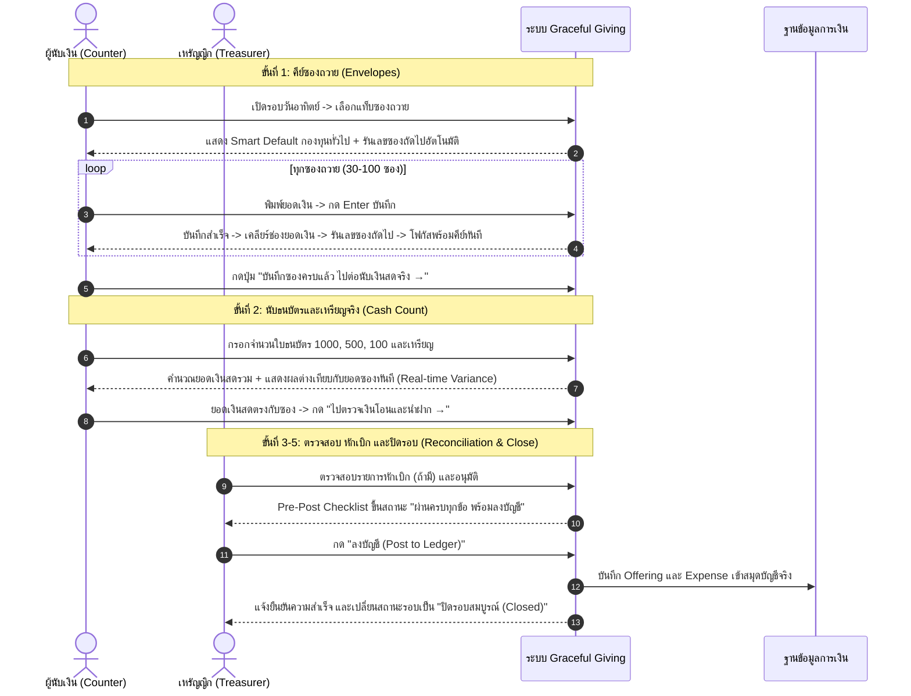
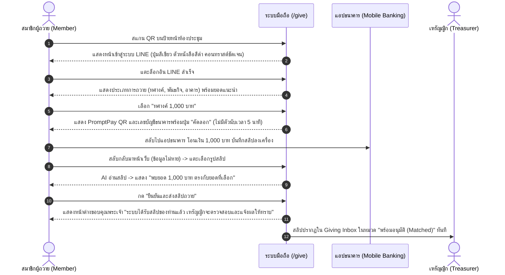

# Graceful Giving — UX Improvement Roadmap & Implementation Blueprint

> **แผนที่นำทางการปรับปรุงประสบการณ์ผู้ใช้งาน (UX Improvement Roadmap)**  
> **ระบบ:** Graceful Giving (ระบบบัญชีและการเงินคริสตจักร — Fintech for Ministry)  
> **หลักการ:** ปรับปรุงตามลำดับผลกระทบ (Impact-Driven), ลดภาระการคิด (Cognitive Load Relief), ลำดับสายตาชัดเจน (Visual Hierarchy), และปฏิบัติตามมาตรฐานการเข้าถึง WCAG 2.2 Level AA  
> **ข้อจำกัดสำคัญ:** รักษา Design System เดิม, ห้ามแตะต้อง Business Logic / Financial Calculations / Database Schema / Auth Matrix

---

## 1. Impact vs Effort Matrix (เมทริกซ์การจัดลำดับความสำคัญ)

การจัดลำดับงานแบ่งตามความคุ้มค่าระหว่าง **ผลกระทบต่อประสบการณ์ผู้ใช้ (User Impact)** กับ **ความซับซ้อนในการพัฒนา (Engineering Effort)**:

```
┌──────────────────────────────────────────────────────────────┐
│                    IMPACT vs EFFORT MATRIX                   │
├───────────────────────────────┬──────────────────────────────┤
│ HIGH IMPACT / LOW EFFORT      │ HIGH IMPACT / HIGH EFFORT    │
│ 🚀 Quick Wins (ทำทันที)       │ 🏗️ Major Projects (เฟส 2)   │
│ • P0-01: แก้ Contrast ปุ่ม LINE│ • P1-05: Stepper 5 ขั้นตอนนับเงิน│
│ • P1-01: นำตัวจับเวลา 5 นาทียกเลิก│ • P1-06: Mobile Sheet กล่องสลิป│
│ • P1-02: เพิ่มปุ่ม "บันทึกซองถัดไป"│ • P2-05: ตารางข้อมูลทางเลือกกราฟ│
│ • P1-03: ปรับข้อความ Pending  │                              │
│ • P2-01: Default กองทุนทั่วไป │                              │
│ • P2-06: ปุ่มตรวจสถานะ Pending│                              │
├───────────────────────────────┼──────────────────────────────┤
│ LOW IMPACT / LOW EFFORT       │ LOW IMPACT / HIGH EFFORT     │
│ 🧹 Fill-ins (เก็บรายละเอียด)   │ ⏳ Low Priority (ไว้ทำทีหลัง)│
│ • P2-02: ใส่ Label htmlFor/ID │ • ปรับปรุงแอนิเมชันขั้นสูง   │
│ • P2-03: ขยายปุ่มจุดเป็น 24px │ • ระบบธีมแบบกำหนดเองเพิ่ม    │
│ • P3-01: เติม Table Scopes    │                              │
│ • P3-02: DialogTitle แก้เตือน │                              │
│ • P3-03: Action การ์ด Counter │                              │
└───────────────────────────────┴──────────────────────────────┘
```

---

## 2. Three-Phase Implementation Roadmap (แผนการปรับปรุง 3 ระยะ)

### ระยะที่ 1: การแก้ไขจุดวิกฤตและความปลอดภัยในการเข้าถึง (Phase 1: Critical Fixes & Foundations)
> **เป้าหมาย:** กำจัดปัญหา P0 และ Quick Wins เพื่อให้ระบบปลอดภัย ใช้งานได้กับทุกคน และลดความวิตกกังวลของผู้ใช้ทันที
- **งานหลัก:**
  1. **แก้ไขสีปุ่ม LINE Login (`FINDING-P0-01`):** ปรับสีตัวอักษรเป็น `text-black` บนพื้นหลัง `#06C755` ทั้งใน `Login.tsx` และ `Give.tsx` เพื่อให้ได้คอนทราสต์ 9.8:1 ผ่านเกณฑ์ WCAG 1.4.3
  2. **เปิดการเข้าถึงแป้นพิมพ์สำหรับส่วนอัปโหลดไฟล์ (`FINDING-P0-02`):** เปลี่ยนจาก `className="hidden"` เป็น `className="sr-only"` และใส่ Focus Ring ให้กล่องลากวางใน `NewExpense.tsx` และ `GivingStation.tsx`
  3. **กักโฟกัสในโมดอล (`FINDING-P0-03`):** ปรับโมดอลปฏิเสธ/ยกเลิกใน `Approvals.tsx` และโมดอลสร้างกองทุนใน `Funds.tsx` ให้ใช้ Radix `<Dialog>` เพื่อป้องกันโฟกัสหลุด
  4. **ยกเลิกตัวนับเวลาถอยหลัง 5 นาทีในหน้าถวายมือถือ (`FINDING-P1-01`):** ปลด `StationCountdownCard` ออกจากโฟลว์ถวายทรัพย์ส่วนตัว เพื่อให้สมาชิกทำรายการด้วยความสงบ
  5. **เพิ่มปุ่ม "บันทึกซองถัดไป" (`FINDING-P1-02`):** เพิ่มปุ่มคีย์ซองต่อเนื่องในโมดอลสำเร็จของ `NewOffering.tsx`
  6. **เปลี่ยนภาษาในหน้า Pending ให้เป็นมิตร (`FINDING-P1-03`):** ซ่อนคำสั่ง Vercel/OWNER_OPEN_ID ไว้ใน Expandable Box และแสดงข้อความสุภาพสำหรับคริสตจักร พร้อมปุ่ม "ตรวจสอบสถานะอีกครั้ง" (`FINDING-P2-06`)

---

### ระยะที่ 2: การปรับปรุงโฟลว์การทำงานและลดภาระการคิด (Phase 2: Workflow & Cognitive Optimization)
> **เป้าหมาย:** ทำให้การนับเงินวันอาทิตย์และการตรวจสลิปเป็นไปอย่างรวดเร็ว ไม่สะดุด และมีตัวช่วยนำทาง
- **งานหลัก:**
  1. **ระบบ Stepper นำทาง 5 ขั้นตอนใน Counting Detail (`FINDING-P1-05`):** เพิ่มแถบสถานะขั้นตอน `1.ซองถวาย → 2.นับเงินสด → 3.เงินโอน → 4.หักเบิก → 5.สรุปปิดรอบ` พร้อมปุ่ม "ไปขั้นตอนถัดไป" ด้านล่างของทุกแท็บ
  2. **Smart Default กองทุนทั่วไป (`FINDING-P2-01`):** กำหนดค่าเริ่มต้นของกองทุนในหน้าบันทึกถวายและหน้านับซองให้เลือก "กองทุนทั่วไป" เสมอ
  3. **Mobile Drawer สำหรับ Giving Inbox (`FINDING-P1-06`):** ปรับให้หน้ารายการสลิปบนมือถือเปิดดูรายละเอียดและปุ่มอนุมัติผ่าน Bottom Sheet เพื่อไม่ต้องเลื่อนหน้าจอยาว
  4. **แปลงการ์ดสลิปให้รองรับคีย์บอร์ด (`FINDING-P1-04`):** เปลี่ยนจาก `<div>` เป็นปุ่มหรือใส่ `role="button"` พร้อมแฮนเดลเลอร์ Enter/Space
  5. **เพิ่ม Action Card บน Dashboard สำหรับผู้นับเงิน (`FINDING-P3-03`):** เมื่อผู้ใช้เป็นบทบาท COUNTER ให้แสดงการ์ดเด่นชัด: *"เริ่มนับเงินถวายวันอาทิตย์นี้"*
  6. **แจ้งเตือนยืนยันก่อนบันทึกยอดเงินสูง (`FINDING-P2-04`):** ดักจับยอดเงินถวายที่เกิน 20,000 บาท เพื่อให้ยืนยันตัวเลขก่อนบันทึกลงบัญชี

---

### ระยะที่ 3: ความประณีตและการแสดงผลข้อมูลที่ครอบคลุม (Phase 3: Polish & Inclusive Data Viz)
> **เป้าหมาย:** เก็บรายละเอียดความสมบูรณ์ของโค้ด การเข้าถึงของตารางและกราฟ
- **งานหลัก:**
  1. **ปรับปรุงกราฟ 6 เดือนในหน้ารายงาน (`FINDING-P2-05`):** แสดงตัวเลขสรุปบนแท่งกราฟ และเพิ่มปุ่มสลับดูเป็นตารางข้อมูล (Data Table Fallback) สำหรับผู้ใช้มือถือและ Screen Reader
  2. **ขยายขนาดพื้นที่สัมผัสปุ่มขั้นตอน (`FINDING-P2-03`):** ปรับปุ่ม Indicator ในวิซาร์ดตั้งค่าให้มีขนาดพื้นที่สัมผัสอย่างน้อย 24x24px
  3. **ผูกมัด Label กับ Input ให้ครบทุกฟิลด์ (`FINDING-P2-02`):** ตรวจทานและใส่ `htmlFor` และ `id` ในทุกอินพุตของฟอร์ม
  4. **เติม Table Scopes (`FINDING-P3-01`):** ใส่ `scope="col"` และ `scope="row"` ในตารางรายงาน
  5. **เปลี่ยนเป็น DialogTitle (`FINDING-P3-02`):** แก้ไขคำเตือนในคอนโซลของ Radix UI

---

## 3. Before / After UX Recommendations (ภาพเปรียบเทียบก่อนและหลังปรับปรุง)

### จุดที่ 1: หน้าเข้าสู่ระบบและสถานะรออนุมัติ (Login & Pending Screen)

```
┌──────────────────────────────────────────────┐  ┌──────────────────────────────────────────────┐
│ BEFORE (เดิม: สับสนด้วยศัพท์เทคนิค)         │  │ AFTER (ปรับปรุง: สุภาพ เข้าใจง่าย มีทางไปต่อ)│
├──────────────────────────────────────────────┤  ├──────────────────────────────────────────────┤
│  [ปุ่มเขียว] เข้าสู่ระบบด้วย LINE           │  │  [ปุ่มเขียว] เข้าสู่ระบบด้วย LINE           │
│  (ตัวหนังสือสีขาวครีม คอนทราสต์ 2.15:1)      │  │  (ตัวหนังสือสีดำเข้ม คอนทราสต์ 9.8:1 ชัดเจน) │
│                                              │  │                                              │
│  สถานะ: รอผู้ดูแลระบบอนุมัติ                  │  │  สถานะ: บัญชีของท่านลงทะเบียนเรียบร้อยแล้ว   │
│  "คุณเข้าสู่ระบบด้วย LINE แล้ว แต่ยังไม่ได้รับ  │  │  "ระบบได้รับข้อมูลแล้ว กรุณาแจ้งผู้ดูแลระบบ   │
│   สิทธิ์ใช้งาน...                             │  │   ของคริสตจักรเพื่อเปิดสิทธิ์การใช้งาน"       │
│                                              │  │                                              │
│  [กล่องส้มมีคำสั่ง]:                          │  │  [ปุ่มส้มหลัก]: ตรวจสอบสถานะอีกครั้ง 🔄      │
│  "คัดลอกรหัส LINE OpenID นี้ไปใส่ใน Vercel   │  │  (กดเพื่อเช็กว่าแอดมินอนุมัติแล้วหรือยัง)    │
│   Environment Variables ที่ช่อง              │  │                                              │
│   OWNER_OPEN_ID แล้วเข้าสู่ระบบใหม่อีกครั้ง..."│  │  [ปุ่มรอง]: ออกจากระบบ                      │
│                                              │  │                                              │
│  [ปุ่มเดียว]: ออกจากระบบ                     │  │  ▶ สำหรับผู้ดูแลระบบทางเทคนิค (กดเพื่อขยาย) │
│  (ผู้ใช้ไม่รู้จะเช็กสถานะอย่างไร)            │  │    (ซ่อนรหัส OpenId และคำสั่งไว้ด้านใน)      │
└──────────────────────────────────────────────┘  └──────────────────────────────────────────────┘
```

---

### จุดที่ 2: โฟลว์การบันทึกซองถวายวันอาทิตย์ (Sunday Bulk Offering Entry)

```
┌──────────────────────────────────────────────┐  ┌──────────────────────────────────────────────┐
│ BEFORE (เดิม: สะดุดและเลือกซ้ำทุกซอง)         │  │ AFTER (ปรับปรุง: ลื่นไหล บันทึกได้ต่อเนื่อง) │
├──────────────────────────────────────────────┤  ├──────────────────────────────────────────────┤
│  1. ประเภทถวาย: [ ทศางค์ ]                   │  │  1. ประเภทถวาย: [ ทศางค์ ]                   │
│  2. จำนวนเงิน: [ 1,000 ]                     │  │  2. จำนวนเงิน: [ 1,000 ]                     │
│  3. เข้ากองทุน: [ — เลือกกองทุน — ] ❌        │  │  3. เข้ากองทุน: [ กองทุนทั่วไป ] ✅           │
│     (ต้องกดเลือกทุกซอง ลืมเลือกโดนฟ้อง Error)│  │     (Smart Default เลือกให้อัตโนมัติ)         │
│  4. วิธีรับเงิน: [ เงินสด ]                   │  │  4. วิธีรับเงิน: [ เงินสด ]                   │
│                                              │  │                                              │
│  [กดบันทึกสำเร็จ] -> แสดง Popup ยินดี         │  │  [กดบันทึกสำเร็จ] -> แสดง Popup ยินดี         │
│  ┌────────────────────────────────────────┐  │  │  ┌────────────────────────────────────────┐  │
│  │ บันทึกการถวายเรียบร้อยแล้ว             │  │  │ │ บันทึกการถวายเรียบร้อยแล้ว             │  │
│  │                                        │  │  │ │ ทศางค์ 1,000 บาท (เงินสด)               │  │
│  │ [ปุ่มเดียว]: ดูรายการถวายทั้งหมด       │  │  │ │                                        │  │
│  │ (เด้งออกจากหน้าฟอร์ม ต้องกดกลับมาใหม่) │  │  │ │ [ปุ่มหลัก]: บันทึกซองถัดไป (Enter) ⚡    │  │
│  └────────────────────────────────────────┘  │  │ │ [ปุ่มรอง]: ดูรายการถวายทั้งหมด          │  │
│                                              │  │  └────────────────────────────────────────┘  │
└──────────────────────────────────────────────┘  └──────────────────────────────────────────────┘
```

---

### จุดที่ 3: กระบวนการนับเงินถวาย 5 ขั้นตอน (Counting Detail 5-Stage Stepper)

```
┌──────────────────────────────────────────────┐  ┌──────────────────────────────────────────────┐
│ BEFORE (เดิม: 5 แท็บแยกกัน ขาดลำดับขั้นตอน)   │  │ AFTER (ปรับปรุง: แนะนำขั้นตอนชัดเจน มีปุ่มนำทาง)│
├──────────────────────────────────────────────┤  ├──────────────────────────────────────────────┤
│  [ซองถวาย] [นับเงินสด] [เงินโอน] [หักเบิก] [สรุป]│  │  ขั้นตอนการนับเงินถวายประจำสัปดาห์:          │
│                                              │  │  (1) ซองถวาย ✔ ── (2) นับเงินสด ── (3) โอน...│
│  (ผู้ใช้ไม่รู้ลำดับงาน และไม่รู้ว่าทำแท็บนี้  │  │                                              │
│   เสร็จแล้วต้องไปไหนต่อ)                     │  │  [เนื้อหาการบันทึกในขั้นตอนนี้]              │
│                                              │  │  ...                                        │
│  [เนื้อหาตาราง]                              │  │                                              │
│  ...                                         │  │  ──────────────────────────────────────────  │
│                                              │  │  [ปุ่มขวาล่าง]: บันทึกซองเสร็จแล้ว            │
│  (ไม่มีปุ่มส่งต่อไปแท็บถัดไป)                 │  │                 ไปต่อนับเงินสดจริง (ขั้นที่ 2) → │
└──────────────────────────────────────────────┘  └──────────────────────────────────────────────┘
```

---

### จุดที่ 4: หน้าถวายทรัพย์บนมือถือของสมาชิก (Member Mobile Giving Flow)

```
┌──────────────────────────────────────────────┐  ┌──────────────────────────────────────────────┐
│ BEFORE (เดิม: มีเวลานับถอยหลังกดดันผู้ถวาย)  │  │ AFTER (ปรับปรุง: ถวายด้วยความสบายใจ ไร้กังวล)│
├──────────────────────────────────────────────┤  ├──────────────────────────────────────────────┤
│  จุดถวายอัตโนมัติ                            │  │  ถวายทรัพย์เพื่อพันธกิจคริสตจักร            │
│                                              │  │                                              │
│  [แถบจับเวลาสีส้ม]:                          │  │  [สรุปรายการที่เลือก]:                      │
│  ⏱️ เวลาทำรายการคงเหลือ 04:32                 │  │  ทศางค์ 1,000 บาท -> กองทุนทั่วไป           │
│  (หมดเวลา 5 นาที ล้างข้อมูลทิ้งทันที!)       │  │                                              │
│                                              │  │  [เลขที่บัญชี & QR Code ชัดเจน]:            │
│  (ผู้สูงอายุสลับไปแอปธนาคาร กลับมาหลุด!)    │  │  ธนาคารกสิกรไทย 012-3-45678-9 [คัดลอก]      │
│                                              │  │                                              │
│  ปุ่ม: [ยังไม่ได้โอน] | [โอนแล้ว]            │  │  [กล้องถ่ายสลิป / แตะแนบรูป]:                │
│  (กดยืนยันว่าโอนแล้ว QR หาย ตรวจซ้ำไม่ได้)   │  │  (แนบสลิปง่าย ตรวจยอดให้อัตโนมัติ)          │
│                                              │  │  (ไม่มีตัวจับเวลากดดัน สลับแอปได้สบายใจ)    │
└──────────────────────────────────────────────┘  └──────────────────────────────────────────────┘
```

---

## 4. Ideal User Journey Specifications (พิมพ์เขียวเส้นทางผู้ใช้งานที่สมบูรณ์)

### พิมพ์เขียวที่ 1: การนับเงินถวายในบ่ายวันอาทิตย์ (Sunday Offering Count Blueprint)
**ผู้ปฏิบัติงาน:** ป้าพรทิพย์ (เหรัญญิก) และ น้องธีร์ (กรรมการนับเงิน)



---

### พิมพ์เขียวที่ 2: การถวายทรัพย์ของสมาชิกผ่านมือถือ (Member Mobile Giving Blueprint)
**ผู้ปฏิบัติงาน:** ลุงมนัส (สมาชิกคริสตจักร)



---

## 5. Guardrails & Regression Prevention Checklist (รายการตรวจสอบป้องกันข้อผิดพลาด)

เพื่อให้มั่นใจว่าการปรับปรุง UX ตามแผนงานนี้จะไม่กระทบต่อระบบอื่น ทีมพัฒนาต้องตรวจสอบเงื่อนไขดังต่อไปนี้ก่อนและหลังการแก้ไข:

- [ ] **Design Tokens Consistency:**
  - ตัวแปรสีทั้งหมดต้องอ้างอิงจาก `client/src/index.css` ห้ามฮาร์ดโค้ดรหัส Hex สีแปลกปลอมลงในคอมโพเนนต์
  - ปุ่ม LINE Login ใช้ `bg-line-brand` คู่กับ `text-[#0A0A0A]` หรือ `text-black` เท่านั้น
- [ ] **Financial Precision & Integrity:**
  - ตัวเลขทางการเงินทุกตัวต้องคงมาตรฐาน `z.number()` และแปลงเป็นทศนิยม 2 ตำแหน่ง (`toFixed(2)`) เพื่อความแม่นยำทางบัญชี
  - ห้ามแตะต้องสูตรคำนวณใน `@shared/counting.ts`, `@shared/givingSplit.ts`, และ `server/db.ts`
- [ ] **Database & API Compatibility:**
  - ห้ามเปลี่ยนแปลง Schema ใน `drizzle/schema.ts` และห้ามแก้ไข tRPC Router Signatures ใน `server/routers.ts`
  - ฟังก์ชันการอ่าน Offering ต้องคงการมาสก์ชื่อผู้ถวาย (`canViewDonorNames`) ไว้เสมอ
- [ ] **Security & Role Gates:**
  - สิทธิ์การเข้าถึงใน `client/src/lib/routeAccess.ts` และ `shared/roles.ts` ต้องสอดคล้องกันอย่างสมบูรณ์
- [ ] **Test Suite Health:**
  - รัน `pnpm check` (tsc --noEmit) ต้องผ่าน 100% ไม่มี Type Error
  - รัน `pnpm test` ต้องผ่านทั้ง 87 ไฟล์ทดสอบ ไม่มีการถดถอย (Regression)
