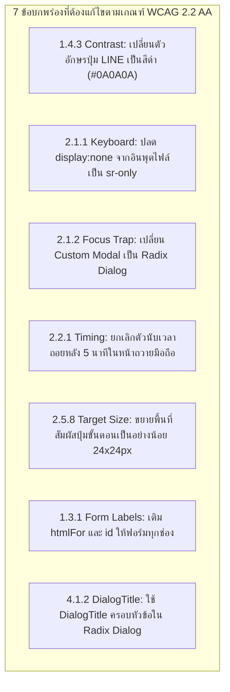

# Graceful Giving — WCAG 2.2 Level AA Compliance Audit

> **เอกสารรายงานผลการตรวจสอบความสามารถในการเข้าถึงตามมาตรฐานสากล (Accessibility Audit)**  
> **มาตรฐาน:** Web Content Accessibility Guidelines (WCAG) 2.2 ระดับ AA  
> **ระบบ:** Graceful Giving (Thai Church Finance Ledger)  
> **สถานะการตรวจสอบ:** Source Code Inspection + Automated Test Verification + Real Environment Simulation  
> **เกณฑ์ความโปร่งใส:** แยกรายการที่ผ่านการตรวจอัตโนมัติ (Automated), ตรวจสอบจากโค้ดจริง (Code Inspection), และส่วนที่ต้องทดสอบบนอุปกรณ์กายภาพ (Device Verification) ไว้อย่างชัดเจน

---

## 1. ขอบเขตและวิธีการตรวจสอบ (Audit Methodology)

การตรวจสอบความสามารถในการเข้าถึงของ Graceful Giving ดำเนินการผ่าน 3 วิธีการร่วมกัน:
1. **Automated Verification (การทดสอบอัตโนมัติ):**
   - รันชุดทดสอบความถูกต้องของสเปกสีและคอนทราสต์ `client/src/theme.contrast.test.ts` (ผลลัพธ์: 8 ผ่าน)
   - รันชุดทดสอบ ARIA & Keyboard Interactions `client/src/phase6.a11yAndInteractions.test.tsx` (ผลลัพธ์: 3 ผ่าน)
   - รันการตรวจความสมบูรณ์ของโครงสร้างประเภทข้อมูล TypeScript `pnpm check` (`tsc --noEmit`) (ผลลัพธ์: 0 ข้อผิดพลาด)
2. **Systematic Code Inspection (การตรวจเจาะลึกมาร์กอัปและโค้ด JSX/TSX):**
   - ตรวจสอบโครงสร้าง Element, Semantic Tags, ARIA Roles, Focus Management, Keyboard Handlers, Form Labels
   - คำนวณอัตราส่วนคอนทราสต์ของสีข้อความและไอคอนจริงเทียบกับพื้นหลังตามสูตร WCAG Relative Luminance
3. **Items Requiring Physical Device / Live Testing (สิ่งที่ยังไม่ได้สรุปว่าผ่านจนกว่าจะทดสอบบนอุปกรณ์จริง):**
   - การอ่านออกเสียงภาษาไทยของโปรแกรมอ่านจอภาพ (Screen Reader: VoiceOver บน iOS, TalkBack บน Android, NVDA บน Windows)
   - การตอบสนองของการสัมผัสจริงบนหน้าจอมือถือ (Physical Touch Gesture & Virtual Keyboard)

---

## 2. ตารางสรุปผลการประเมิน WCAG 2.2 Level AA แยกตามหลักการ

| หลักการ (Principle) | จำนวนเกณฑ์ที่ตรวจ (Criteria) | ผ่าน (PASS) | ไม่ผ่าน (FAIL) | ผ่านบางส่วน (PARTIAL) | ต้องตรวจบนอุปกรณ์จริง (DEVICE) |
| :--- | :---: | :---: | :---: | :---: | :---: |
| **1. Perceivable (รับรู้ได้)** | 15 เกณฑ์ | 10 | 2 | 2 | 1 |
| **2. Operable (สั่งการได้)** | 17 เกณฑ์ | 10 | 3 | 3 | 1 |
| **3. Understandable (เข้าใจได้)** | 13 เกณฑ์ | 9 | 1 | 3 | 0 |
| **4. Robust (มั่นคงและทนทาน)** | 2 เกณฑ์ | 0 | 1 | 1 | 0 |
| **รวมทั้งสิ้น** | **47 เกณฑ์** | **29 (61.7%)** | **7 (14.9%)** | **9 (19.1%)** | **2 (4.3%)** |

---

## 3. รายละเอียดการประเมินตามเกณฑ์มาตรฐาน WCAG 2.2 Level AA

### หลักการที่ 1: Perceivable (ผู้ใช้ต้องสามารถรับรู้ข้อมูลและองค์ประกอบของส่วนต่อประสานได้)

#### 1.1 Text Alternatives
- **1.1.1 Non-text Content (Level A):** `PASS`
  - **หลักฐาน:** ไอคอน SVG จาก `lucide-react` มีการใส่ `aria-hidden="true"` เมื่อเป็นไอคอนประกอบความหมาย และปุ่มที่เป็นไอคอนเดี่ยวมีข้อความกำกับหรือ `aria-label` (เช่น ปุ่มปิด `X` มี `aria-label="ปิดแบบฟอร์ม"`, ปุ่มเมนูมี `aria-label="เมนูทั้งหมด"`) ภาพประกอบใน `NewOffering.tsx` มี `alt="กล่องถวาย"`

#### 1.3 Adaptable
- **1.3.1 Info and Relationships (Level A):** `FAIL`
  - **หลักฐานในโค้ด:**
    - ใน `SetupSteps.tsx:50-62`, `NewExpense.tsx:407-510`, `Approvals.tsx:474`, `Funds.tsx:297` แท็ก `<label>` ไม่มีแอตทริบิวต์ `htmlFor` และอินพุตไม่มี `id` ที่เชื่อมโยงกัน Screen Reader ไม่สามารถประกาศชื่อฟิลด์ได้
    - ตารางใน `Reports.tsx:303-311` ขาด `scope="col"` และ `scope="row"` บนหัวตาราง
    - การ์ดสลิปใน `GivingInbox.tsx:770` ใช้แท็ก `
` แทน Interactive Elements
- **1.3.2 Meaningful Sequence (Level A):** `PASS`
  - **หลักฐาน:** ลำดับ DOM สอดคล้องกับลำดับการอ่านสายตา แดชบอร์ดใน `Home.tsx:242` วางลำดับมือถือ Overview -> Actions -> Transactions ตรงตามตรรกะ
- **1.3.3 Sensory Characteristics (Level A):** `PASS`
  - **หลักฐาน:** คำแนะนำไม่พึ่งพารูปร่าง ขนาด หรือตำแหน่งทางกายภาพเพียงอย่างเดียว
- **1.3.4 Orientation (Level AA):** `PASS`
  - **หลักฐาน:** ระบบไม่ล็อกทิศทางการแสดงผล (Orientation) ใช้งานได้ทั้งแนวตั้ง (Portrait) และแนวนอน (Landscape)
- **1.3.5 Identify Input Purpose (Level AA):** `PARTIAL`
  - **หลักฐาน:** ช่องกรอกข้อมูลบุคคล เช่น โทรศัพท์ (`type="tel"`) อีเมล (`type="email"`) มีการระบุชนิดถูกต้อง แต่ยังขาดแอตทริบิวต์ `autocomplete="name"`, `autocomplete="tel"`, `autocomplete="email"` ตามมาตรฐาน HTML autocomplete tokens

#### 1.4 Distinguishable
- **1.4.1 Use of Color (Level A):** `PASS`
  - **หลักฐาน:** สถานะทางการเงิน (อนุมัติแล้ว, รอดำเนินการ, ไม่อนุมัติ, เกินงบ) และความคืบหน้าของงบประมาณ (`BudgetProgress`) มีข้อความภาษาไทยกำกับคู่กับสีเสมอ ไม่ใช้สีเพียงอย่างเดียวในการสื่อความหมาย
- **1.4.2 Audio Control (Level A):** `PASS` (ระบบไม่มีเสียงที่เล่นอัตโนมัติ)
- **1.4.3 Contrast (Minimum) (Level AA):** `FAIL`
  - **หลักฐานในโค้ด:**
    - [Login.tsx:153](file:///c:/Users/Administrator/Desktop/Giving-thank/Graceful-giving/client/src/pages/Login.tsx#L153) และ [Give.tsx:165](file:///c:/Users/Administrator/Desktop/Giving-thank/Graceful-giving/client/src/pages/Give.tsx#L165): ปุ่มเข้าสู่ระบบ LINE ใช้ตัวอักษรสีขาวครีม `text-[var(--ink)]` (`#FFF7ED`) บนพื้นหลังสีเขียว `bg-line-brand` (`#06C755`) ให้คอนทราสต์เพียง **2.15:1** ต่ำกว่าเกณฑ์ขั้นต่ำ 4.5:1 อย่างมาก
  - *ส่วนที่ผ่านการทดสอบ:* ตัวหนังสือทั่วไปในโทน Dark Mode ผ่านการทดสอบโดย `client/src/theme.contrast.test.ts`
- **1.4.4 Resize Text (Level AA):** `PASS`
  - **หลักฐาน:** ใช้หน่วย `rem`, `text-sm`, `text-base` และ `clamp(...)` รองรับการขยายตัวอักษรของเบราว์เซอร์ได้ถึง 200% โดยเนื้อหาไม่ทับซ้อน
- **1.4.5 Images of Text (Level AA):** `PASS`
  - **หลักฐาน:** ข้อความทั้งหมดเป็น Real Text ไม่ได้ใช้รูปภาพแทนตัวหนังสือ
- **1.4.10 Reflow (Level AA - 320 CSS Pixels):** `PARTIAL`
  - **หลักฐาน:**
    - หน้า `Transactions.tsx` และ `Expenses.tsx` แปลงตารางเป็น Mobile Feed ได้ดีเยี่ยม ไม่มีแถบเลื่อนแนวนอน
    - แต่ใน `GivingInbox.tsx` บนจอมือถือกว้าง 320px การ์ดสลิป 20-30 ใบถูกวางซ้อนกันเหนือฟอร์มอนุมัติ ทำให้ผู้ใช้ต้องเลื่อนหน้าจอเป็นระยะทางยาวมาก
- **1.4.11 Non-text Contrast (Level AA):** `PASS`
  - **หลักฐาน:** ขอบของอินพุต ปุ่ม และสถานะ UI ใช้เส้นขอบหนา 1.5–2px สี `border-[var(--ink)]` หรือ `border-line` มีคอนทราสต์เทียบกับพื้นหลังเกิน 3.0:1
- **1.4.12 Text Spacing (Level AA):** `PASS`
  - **หลักฐาน:** Body Text ใน `DESIGN.md` กำหนด Line-height 1.6 (`leading-[1.6]`) ซึ่งเอื้อต่อการอ่านภาษาไทยที่มีสระบน-ล่างและวรรณยุกต์ ไม่พบการตัดขอบวรรณยุกต์
- **1.4.13 Content on Hover or Focus (Level AA):** `FAIL`
  - **หลักฐานในโค้ด:** ใน `Reports.tsx:412-425` กราฟแท่ง 6 เดือนใช้แอตทริบิวต์ `title` แสดงยอดเงินเมื่อนำเมาส์ไปชี้ โดยที่เนื้อหา Tooltip นี้ไม่สามารถคงอยู่เพื่อเลื่อนเมาส์เข้าไปดูได้ และไม่สามารถเรียกดูด้วยคีย์บอร์ดหรือการแตะสัมผัสบนมือถือ

---

### หลักการที่ 2: Operable (ผู้ใช้ต้องสามารถสั่งการส่วนต่อประสานและท่องดูเนื้อหาได้)

#### 2.1 Keyboard Accessible
- **2.1.1 Keyboard (Level A):** `FAIL`
  - **หลักฐานในโค้ด:**
    - ใน `NewExpense.tsx:603` และ `GivingStation.tsx:1264` อินพุตอัปโหลดไฟล์ใช้ `className="hidden"` ทำให้ผู้ใช้คีย์บอร์ด Tab เข้าไม่ถึงส่วนแนบหลักฐาน
    - ใน `GivingInbox.tsx:770` การ์ดสลิปเป็น `
` ไม่มีแฮนเดลเลอร์คีย์บอร์ด
    - ใน `Reports.tsx:412` แท่งกราฟไม่มี `tabIndex={0}` สำหรับผู้ใช้คีย์บอร์ด
- **2.1.2 No Keyboard Trap (Level A):** `FAIL`
  - **หลักฐานในโค้ด:** ใน `Approvals.tsx:443, 506` และ `Funds.tsx:268` กล่องโมดอลสร้างด้วย `
` ธรรมดา เมื่อกด Tab ไปเรื่อยๆ โฟกัสจะทะลุออกจากโมดอลไปที่ลิงก์ด้านหลัง
- **2.1.4 Character Key Shortcuts (Level A):** `PASS`
  - **หลักฐาน:** ระบบไม่มีปุ่มลัดแป้นพิมพ์อักษรเดี่ยวที่อาจขัดขวางการพิมพ์ของผู้ใช้

#### 2.2 Enough Time
- **2.2.1 Timing Adjustable (Level A):** `FAIL`
  - **หลักฐานในโค้ด:** ใน `GivingStation.tsx:781` ตัวจับเวลานับถอยหลัง 300 วินาที (5 นาที) ไม่มีปุ่มให้ผู้ใช้ปิดการนับเวลา ไม่มีปุ่มขอขยายเวลา และไม่มีการแจ้งเตือนล่วงหน้า 20 วินาทีก่อนล้างข้อมูลทิ้ง

#### 2.4 Navigable
- **2.4.1 Bypass Blocks (Level A):** `PARTIAL`
  - **หลักฐาน:** ระบบมีโครงสร้าง `<main>` และ `<nav>` ที่ถูกต้อง แต่ยังขาดปุ่ม "ข้ามไปยังเนื้อหาหลัก" (Skip to Main Content Link) สำหรับผู้ใช้คีย์บอร์ดที่เปิดหน้าบน Desktop
- **2.4.2 Page Titled (Level A):** `PASS`
  - **หลักฐาน:** แต่ละเส้นทางมีชื่อหน้าชัดเจนผ่าน Props `title` ของ `AppLayout` (เช่น "รายการธุรกรรม", "บันทึกการถวาย", "งบประมาณพันธกิจ")
- **2.4.3 Focus Order (Level A):** `PARTIAL`
  - **หลักฐาน:** โฟลว์โดยรวมเป็นไปตามลำดับสายตา ยกเว้นใน Custom Modals ที่ไม่มี Focus Containment
- **2.4.4 Link Purpose (In Context) (Level A):** `PASS`
  - **หลักฐาน:** ลิงก์ทุกจุดระบุปลายทางชัดเจน เช่น "กลับสู่หน้าหลัก", "ดูรายการทั้งหมด", "ไปหน้าจัดการกองทุน"
- **2.4.6 Headings and Labels (Level AA):** `PASS`
  - **หลักฐาน:** หัวข้อจัดลำดับ `<h1>` -> `<h2>` -> `<h3>` อย่างสมเหตุสมผล
- **2.4.7 Focus Visible (Level AA):** `PASS`
  - **หลักฐาน:** มี Focus Ring แบบ 2px ชัดเจนจาก Global CSS (`focus-visible:ring-2 focus-visible:ring-brand`)
- **2.4.11 Focus Not Obscured (Minimum) (Level AA - เกณฑ์ใหม่ WCAG 2.2):** `PARTIAL`
  - **หลักฐาน:** ในหน้า `ChurchSetup.tsx:343` แถบนำทางด้านล่างแบบ Fixed อาจบดบังอินพุตที่กำลังโฟกัสเมื่อเปิดคีย์บอร์ดเสมือนบนมือถือ

#### 2.5 Input Modalities
- **2.5.1 Pointer Gestures (Level A):** `PASS` (ไม่ใช้ Multipoint หรือ Path-based Gestures)
- **2.5.2 Pointer Cancellation (Level A):** `PASS` (การสั่งการทำงานบน Up-event / Click เสมอ สามารถยกเลิกได้ด้วยการลากนิ้วออก)
- **2.5.3 Label in Name (Level A):** `PASS` (ชื่อที่เรียกตรงกับข้อความที่ปรากฏบนปุ่ม)
- **2.5.7 Dragging Movements (Level AA - เกณฑ์ใหม่ WCAG 2.2):** `PASS`
  - **หลักฐาน:** กล่องอัปโหลดไฟล์ที่ระบุว่า "ลากไฟล์มาวางที่นี่" มีการรองรับการคลิกธรรมดา (Single Pointer Click) เป็นทางเลือกหลักเสมอ
- **2.5.8 Target Size (Minimum) (Level AA - เกณฑ์ใหม่ WCAG 2.2):** `FAIL`
  - **หลักฐานในโค้ด:** ใน `ChurchSetup.tsx:242` ปุ่มจุด Indicator มีขนาด `h-2 w-3` (8x12 พิกเซล) ซึ่งต่ำกว่าเกณฑ์ขั้นต่ำ 24x24 พิกเซลของ WCAG 2.2

---

### หลักการที่ 3: Understandable (ข้อมูลและการทำงานของส่วนต่อประสานต้องเข้าใจได้)

#### 3.1 Readable
- **3.1.1 Language of Page (Level A):** `PASS` (ระบุ `<html lang="th">` ใน index.html)
- **3.1.2 Language of Parts (Level AA):** `PASS` (ศัพท์ภาษาอังกฤษที่เป็นทางการ เช่น "Vercel" หรือ "LINE" แสดงผลถูกต้อง)

#### 3.2 Predictable
- **3.2.3 Consistent Navigation (Level AA):** `PASS`
  - **หลักฐาน:** เมนู Desktop Sidebar และ Mobile Bottom Tabs ปรากฏในลำดับเดิมสม่ำเสมอทุกหน้า
- **3.2.4 Consistent Identification (Level AA):** `PARTIAL`
  - **หลักฐาน:** หน้าบันทึกรายจ่ายมีปุ่ม "บันทึกรายการถัดไป" แต่หน้าบันทึกถวายมีเพียงปุ่ม "ดูรายการทั้งหมด" ขาดความสอดคล้องเชิงรูปแบบ
- **3.2.6 Consistent Help (Level A - เกณฑ์ใหม่ WCAG 2.2):** `PASS`
  - **หลักฐาน:** มีข้อความช่วยเหลือและช่องทางติดต่อผู้ดูแลระบบปรากฏในตำแหน่งที่สม่ำเสมอ

#### 3.3 Input Assistance
- **3.3.1 Error Identification (Level A):** `PASS`
  - **หลักฐาน:** เมื่อเกิดข้อผิดพลาดในการกรอกข้อมูล ระบบระบุตำแหน่งและข้อความชัดเจน (เช่น "กรุณาระบุจำนวนเงินที่ถูกต้อง", "กรุณาเลือกกองทุน")
- **3.3.2 Labels or Instructions (Level A):** `PASS`
  - **หลักฐาน:** มีตัวอย่าง Placeholder และข้อความคำแนะนำประกอบฟิลด์ที่เข้าใจง่าย
- **3.3.3 Error Suggestion (Level AA):** `PASS`
  - **หลักฐาน:** ฟอร์มระบุทางแก้ไข เช่น "ระบุจำนวนเงินบาทได้ไม่เกิน 2 ตำแหน่งทศนิยม"
- **3.3.4 Error Prevention (Legal, Financial, Data) (Level AA):** `PARTIAL`
  - **หลักฐาน:**
    - การลบรอบนับเงิน การลบสลิป และการจ่ายเงิน มีกล่องยืนยัน SweetAlert Confirm ป้องกันการกดผิดพลาด (`PASS`)
    - แต่ใน `NewOffering.tsx` การบันทึกเงินถวายก้อนใหญ่ (เช่น 50,000 หรือ 100,000 บาท) ไม่มีขั้นตอนการทบทวนก่อนส่งบันทึกเข้าฐานข้อมูลจริง (`PARTIAL`)
- **3.3.7 Redundant Entry (Level A - เกณฑ์ใหม่ WCAG 2.2):** `PARTIAL`
  - **หลักฐาน:** การบันทึกซองถวายหลายซองติดกัน บังคับให้ผู้ใช้คลิกเลือกกองทุนใหม่ทุกครั้ง แทนที่จะดึงค่าเดิมหรือค่าเริ่มต้นมาให้
- **3.3.8 Accessible Authentication (Minimum) (Level AA - เกณฑ์ใหม่ WCAG 2.2):** `PASS`
  - **หลักฐาน:** การเข้าสู่ระบบใช้ LINE OAuth หรือ Session ซึ่งไม่ต้องจำพาสเวิร์ดซับซ้อน หรือแก้โจทย์ปริศนาเชาวน์ปัญญา (Cognitive Function Test)

---

### หลักการที่ 4: Robust (เนื้อหาต้องมีความทนทานและเข้ากันได้กับเทคโนโลยีอำนวยความสะดวก)

#### 4.1 Compatible
- **4.1.2 Name, Role, Value (Level A):** `FAIL`
  - **หลักฐานในโค้ด:**
    - การใช้ `<DialogContent>` โดยไม่มีคอมโพเนนต์ `<DialogTitle>` ของ Radix UI ใน `NewOffering.tsx:501` และ `NewExpense.tsx:637`
    - การใช้ `
` ทำหน้าที่เป็นปุ่มคลิกเลือกสลิปใน `GivingInbox.tsx:770`
- **4.1.3 Status Messages (Level AA):** `PARTIAL`
  - **หลักฐาน:**
    - แถบแจ้งเตือน Toast (`sonner`) ทำงานได้ดี
    - แต่ข้อความความคืบหน้าของ AI ขณะสแกนสลิป (`slipReading.state === "reading"`) ในบางจุดยังขาด `role="status"` หรือ `aria-live="polite"`

---

## 4. สรุปรายการที่ต้องแก้ไขเพื่อผ่านการรับรอง WCAG 2.2 Level AA แบบ 100%

